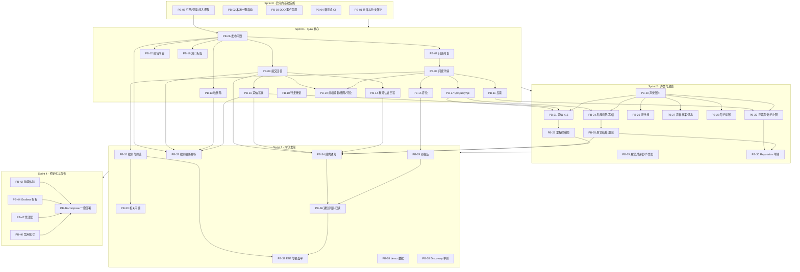

# PBI 依赖关系图（V3 §5.5）

> 审计 W-04 收口（2026-11-25，PO 魏志国）：全仓库此前没有「依赖图 / 前置 PBI」产物，本节补齐。
> 画法：以**交付顺序**（Sprint 主轴）为主干，箭头表示「前者必须先于后者存在」。同一 Sprint 内的强依赖单独标注。
> 主数据源：[`product-backlog.md`](product-backlog.md)（48 条 PBI 的优先级/点数/归属迭代）。

---

## 1. 总览（Sprint 主干 + 上下文依赖）

## 2. 关键前置关系（文字版，供评审逐条核对）

| PBI | 前置（必须先完成） | 原因 |
| --- | --- | --- |
| PB-06 发布问题 | PB-05 | 需要已登录用户与课程归属 |
| PB-08 详情 / PB-07 列表 | PB-06 | 读模型来自发布事件投影 |
| PB-09 提交回答 → PB-10 采纳 | PB-09 → PB-10 | 采纳需要已存在的回答 |
| PB-11 投票 / PB-15 评论 / PB-14 教师认证 | PB-08 / PB-09 | 目标对象必须先存在 |
| **PB-17 QaQueryApi** | PB-08 | Reputation/Discovery 跨上下文问「问题是否开放、作者是谁」的唯一入口 |
| PB-20 声誉账户 | PB-05 | 注册事件触发开户 |
| **PB-21 采纳 +15 / PB-22 投票声誉** | PB-10 / PB-11 + PB-17 + PB-20 | 计分靠 Q&A 事件 + 查问题引用 + 账户 |
| **PB-24 发起悬赏** | PB-17 + PB-20 | 需课程归属（REP-1007）与可冻结余额 |
| PB-25 结算/退款 | PB-24 + PB-10 | 采纳事件触发结算，到期触发退款 |
| PB-26 排行榜 | PB-20 | 读账户与周期流水 |
| **PB-31/32/33 搜索投影** | Q&A 事件族（PB-06/09/10/13） | 投影由 `QuestionPosted`/`AnswerSubmitted`/`AnswerAccepted`/`ContentDeleted` 驱动 |
| **PB-34/35/36 通知** | PB-09/10/14/25/23 + PB-15 | 通知由回答/采纳/认证/悬赏/徽章/评论事件驱动 |
| PB-37 E2E 与覆盖率 | PB-31 + PB-36 | 端到端链路需搜索与通知就绪 |
| **PB-46 compose 一键部署** | PB-40/42/44/47 | 发布门槛要求全部 S4 项就绪 |

## 3. 与 V3 §5.5 的对应

- V3 §5.5 要求「按依赖关系排出实现顺序，识别可并行项」。本图同时给出：
  - **串行主轴**：S0 → S1 → S2 → S3 → S4（受跨上下文事件契约约束）；
  - **可并行簇**：
    - S1 内：`PB-12/13/15/16` 可与 `PB-09/10` 并行（均依赖 PB-06/08，互不依赖）；
    - S2 内：`PB-23/26/27/28` 可与 `PB-24/25` 并行（前者读账户，后者走悬赏结算）；
    - S3 内：`PB-31/33`（搜索/推荐）与 `PB-34/35/36`（通知）可并行，二者只在 `PB-37` 汇合。
- 维护约定：新增/调整 PBI 时，**同时更新本图与第 2 节表格**；若某 PBI 的前置被移出迭代，需在 `s4-deferred-items-decision.md` 记录影响面。
