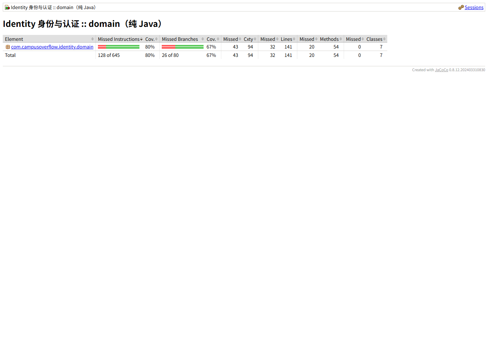
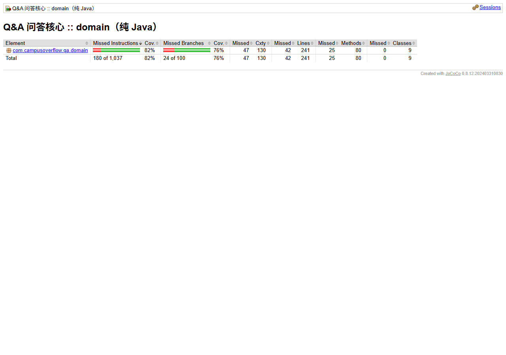
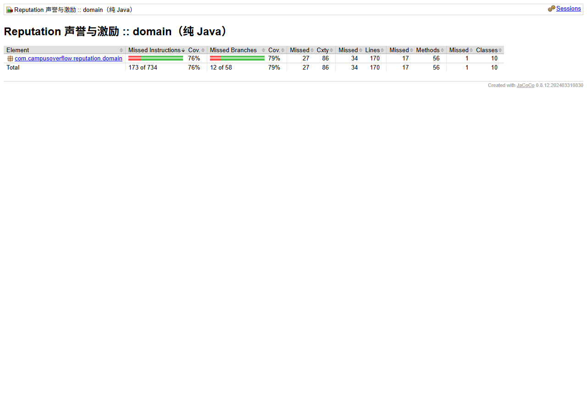
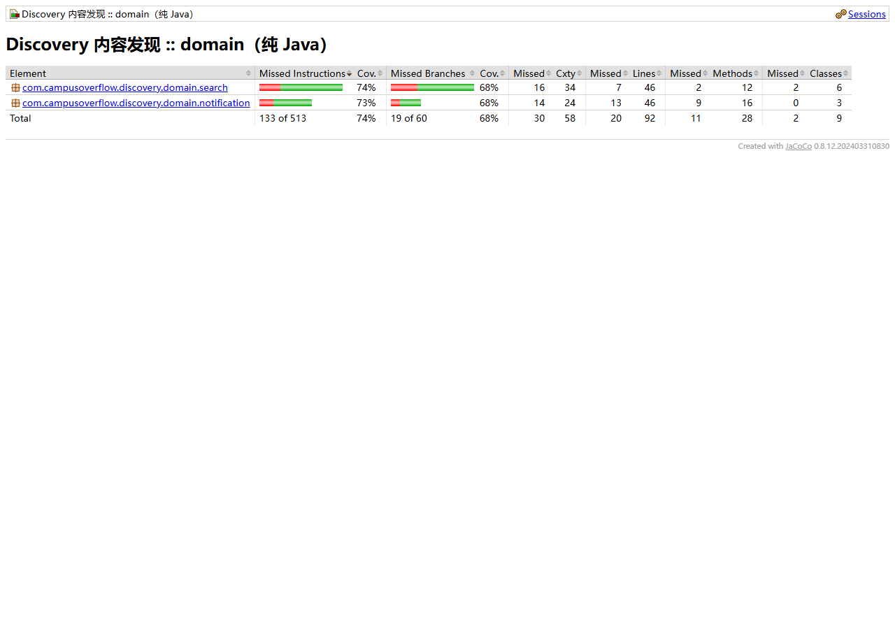

# 3. 质量证据

> 答辩口径：先给结论（CI 门禁全绿、覆盖率达标、端到端可跑、**Sonar 质量门禁 PASSED**），再按需展开 CI 与报告。
> 数据截至：2026-11-27（最新 CI 全量 + 四域覆盖率重采）。

## 3.1 CI 门禁（五个后端阶段 + 前端）

`.github/workflows/ci.yml`：

| 阶段 | 命令 | 作用 |
| --- | --- | --- |
| 1 编译 | `mvn -f backend/pom.xml clean compile` | 全仓编译 |
| 2 单元测试 | `mvn test` | 全量单元测试（27 模块） |
| 3 架构约束 | `mvn test -pl co-bootstrap -Dtest=ArchitectureTest` | ArchUnit 分层/依赖（FF-4） |
| 4 覆盖率门禁 | `mvn verify -DskipITs -Djacoco.skip=false` | 全量 domain 行覆盖 ≥ 0.70 |
| 5 集成测试 | `mvn verify -Dtest=none -Dsurefire.failIfNoSpecifiedTests=false` | 硬门禁：Testcontainers 起 MySQL/Redis，失败即阻断 |
| 前端 | `npm run lint` + `npm run format:check` + `npm run typecheck` + `npm run test:run` + `npm run build` | ESLint、Prettier、类型检查、组件单测（Vitest）、构建 |

S4 收口起删除 `SPRINT_MODULES`，单元测试与覆盖率门禁恢复全量模块；集成测试同时改为硬门禁。

> 前端阶段自 PR #231 起增加「单元测试（组件）」步骤（`npm run test:run`），与 ESLint、Prettier、typecheck、build 共同构成前端门禁。

## 3.2 测试与覆盖率

| 模块 | 测试数 | 行覆盖率 | 门槛 |
| --- | ---: | ---: | --- |
| co-shared-kernel | 3 | — | — |
| co-identity-domain | 13 | 77.30% | ✅ ≥70% |
| co-identity-application | 8 | — | — |
| co-identity-infrastructure | 1 | — | — |
| co-qa-domain | 44 | 82.57% | ✅ |
| co-qa-api | 8 | — | — |
| co-qa-application | 56 | — | — |
| co-qa-infrastructure | 6 | — | — |
| co-reputation-domain | 20 | 80.00% | ✅ |
| co-reputation-application | 62 | — | — |
| co-reputation-infrastructure | 3 | — | — |
| co-discovery-domain | 6 | 78.49% | ✅ |
| co-discovery-application | 26 | — | — |
| co-bootstrap | 12（ArchUnit 1 + FlowIT 4 + 其他 7） | — | 分层约束 + 端到端 |

> 覆盖率来自 JaCoCo `jacoco.csv` 汇总（LINE COVERED / (COVERED+MISSED)）；四个 domain 模块均通过 `check-domain-coverage`。

> 2026-11-27 CI 全量 **268** 个用例（surefire/failsafe XML 汇总；其中 FlowIT 4 个）。此前的 168/174/204 为历史批次，已过期。

> **口径说明（审计 P-02/04/10）**：上表与「268 用例」由 surefire/failsafe 的 XML 汇总得出；
> 历史文档里出现过的 165 / 168 / 174 / 204 / 252 是不同日期、不同参数（是否 `-DskipITs`、是否含 failsafe、
> 合并前后）的批次，引用时必须注明日期与命令，不要混用。

四个 domain 模块的报告截图与原始 CSV 逐模块归档（不复用同一张图，便于当场复核）：

| 模块 | 行覆盖 | 行覆盖率 | 分支覆盖 | 报告截图 | 原始 CSV |
| --- | ---: | ---: | ---: | --- | --- |
| `co-identity-domain` | 109 / 141 | **77.30%** | 54 / 80（67.50%） | [`coverage-identity.png`](screenshots/coverage/coverage-identity.png) | [`coverage-identity.csv`](screenshots/coverage/coverage-identity.csv) |
| `co-qa-domain` | 199 / 241 | **82.57%** | 76 / 100（76.00%） | [`coverage-qa.png`](screenshots/coverage/coverage-qa.png) | [`coverage-qa.csv`](screenshots/coverage/coverage-qa.csv) |
| `co-reputation-domain` | 136 / 170 | **80.00%** | 46 / 58（79.31%） | [`coverage-reputation.png`](screenshots/coverage/coverage-reputation.png) | [`coverage-reputation.csv`](screenshots/coverage/coverage-reputation.csv) |
| `co-discovery-domain` | 73 / 93 | **78.49%** | 42 / 62（67.74%） | [`coverage-discovery.png`](screenshots/coverage/coverage-discovery.png) | [`coverage-discovery.csv`](screenshots/coverage/coverage-discovery.csv) |

| | |
| :---: | :---: |
|  |  |
|  |  |

> 采集口径与复现命令见 [`screenshots/coverage/README.md`](screenshots/coverage/README.md)（采集人 陈明哲，2026-11-25，基于最新 CI `jacoco-coverage-reports` 工件重新生成 CSV/截图）。

## 3.3 端到端与冒烟

- **T1-15 主链路脚本**：CSRF → 注册 → 登录 → 发问题 → 另一账号回答 → 投票 → 采纳 → 详情校验，`SMOKE PASS`（2026-11-15，demo profile + MySQL/Redis）；用法见 [`scripts/smoke/README.md`](../../scripts/smoke/README.md)。
- **搜索**：单字关键词 422 `DIS-1001`；中文词命中依赖 `SearchIndexProjector` 投影（S3 已实现）。
- **声誉/悬赏**：采纳 +15、悬赏 50 分结算/自答退款/到期退款均有日志与测试（[`docs/scrum/sprint-2.md`](../scrum/sprint-2.md) §六）。
- **demo profile**：`DemoDataSeeder` 6 账号 / 1 课程 / 3 问题，重启幂等（[`docs/reports/t2-14-demo-profile.md`](../reports/t2-14-demo-profile.md)）。

## 3.4 缺陷台账

[`docs/qa/defects.md`](../qa/defects.md) 当前：

| 状态 | 条目 |
| --- | --- |
| 已修复 | BUG-001 课程页、BUG-002 PR 无 CI、BUG-003 分支保护必需检查、BUG-004 DDD 不一致（14 事件版，PNG 已重绘）、BUG-005 提交身份、BUG-006 团队文档/ADR-009 |

BUG-003 于 2026-11-17 复核关闭：`main` 为 2 Approve + 后端/前端/容器三项必需检查，`develop` 为 1 Approve + 后端/前端两项必需检查（规则集 `develop required checks`，`enforce_admins=true`）；`容器镜像构建` 因 `if` 限定 `push` / `base=main`，只挂 `main`。证据见 [`docs/qa/defects.md`](../qa/defects.md#复核记录)。

## 3.5 发布验证

- `v0.1.0` → `704cd60`（S0 基线，补打）
- `v0.2.0` → `a381bb8`（S1 基线，补打）
- `v0.3.0` → `a4114dc`（main，PR #115）：CI 后端/前端/容器镜像三阶段绿
- `v0.9.0` → `579ea59`（S3 RC tag；正式内容随 v1.0.0 进 main）
- `v1.0.0` → `10925c7`（main，PR #135；GitHub Release）

详见 [`docs/reports/release-v0.2.0-v0.3.0.md`](../reports/release-v0.2.0-v0.3.0.md)。
- 可观测性四面板与对账指标演练：[`docs/reports/t4-04-observability.md`](../reports/t4-04-observability.md)；UI 截图 [`screenshots/grafana/grafana-four-panels.png`](screenshots/grafana/grafana-four-panels.png)

## 3.6 复现命令

```powershell
# 全仓（27 模块）构建与测试
mvn -B -f backend/pom.xml verify -DskipITs -Djacoco.skip=false

# CI 阶段 2：全量单元测试
mvn -B -f backend/pom.xml test

# CI 阶段 5：集成测试硬门禁（需 Docker）
mvn -B -f backend/pom.xml verify -Dtest=none -Dsurefire.failIfNoSpecifiedTests=false
```

> 2026-11-16 实跑：全仓 27 个模块 `mvn verify -DskipITs -Djacoco.skip=false` → **BUILD SUCCESS**（含 ArchUnit 1 条）。

## 3.7 已知风险

| 风险 | 影响 | 处置 |
| --- | --- | --- |
| BUG-003（已关闭） | 曾因 develop 无必需状态检查，CI 失败不一定阻断合并 | 2026-11-17 通过规则集 #27436601 启用 `后端构建与验证`/`前端构建`；`enforce_admins=true`，改作业名需同步规则集 |
| 本地 JDK 25 下 JaCoCo 0.8.12 agent 不兼容 | 本机取证需 `-Djacoco.skip=true` | 统一用 JDK 21 取证；CI 固定 21 |
| 集成测试已硬门禁 | 失败即阻断，不再漏过端到端问题 | 阶段 5 移除了 `continue-on-error`，Testcontainers 起 MySQL/Redis；见 ADR-009 |
| Sonar Quality Gate（baseline PASSED，HEAD 待复扫） | 曾因 `java:S5998` 与覆盖率卡线导致 Lab 7 门禁 Failed | 2026-11-25 baseline `3750111` 复扫 **Gate PASSED**（Bugs 0 / Vulnerabilities 0 / 安全热点 100% / Coverage 73.8% / 219 单测）；该 baseline 早于当前 HEAD `62332d2`，最终 HEAD 尚未复扫，不能写成“最终代码已通过” |
| 排行榜 Redis 数据可重建 | 周期榜为派生数据，Redis 丢失/误清会偏低 | 2026-11-25 实现 `LeaderboardService.rebuild` + `POST /api/v1/admin/leaderboard/rebuild`，以声誉账本为准重算；总榜读账户表不受影响 |
| Sonar 覆盖率 73.8% 接近 70% 阈值 | 新增低覆盖代码可能让门禁回红 | 新代码需带测试；`infrastructure/interfaces` 已按既有政策排除；当前 New Code 覆盖率 88.2% |
