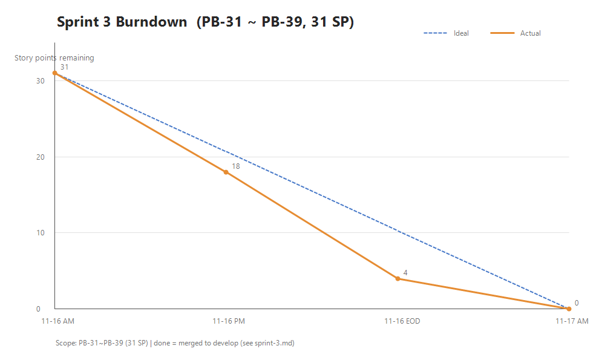

# Sprint 3 · 计划（Discovery：搜索投影 / 通知中心 / 相关推荐）

> Scrum Master：房国栋（D，角色卡 S3 既定）　PO：魏志国
> 时间盒（计划）：2026-11-23 ～ 2026-12-04，10 个工作日；**实际执行：2026-11-16 ～ 2026-11-17（2 天，S2 提前收口后接续，窗口前移）**
> 范围：PB-31～PB-39（Discovery / 搜索与通知，31 SP）；范围来源：[`docs/backlog/product-backlog.md`](../backlog/product-backlog.md)
> **PB-40（禁用违规账号并下线，5 SP）属 S4 范围（T4-02，负责人魏志国）**，不计入 S3 的 31 SP；此处与 backlog「归属迭代」列一致。
> 状态：**已执行并收口（2026-11-17）**；燃尽图 [`sprint-3-burndown.png`](sprint-3-burndown.png) 已归档
> S3 目标（角色卡口径）：**移除全部行走骨架，`mvn verify` 全绿**；搜索、推荐、通知三处在界面可用。
>
> 收口说明：本文件原为 PO 代拟草案，S3 在 11-16～11-17 压缩执行完毕，SM 未另出计划会纪要；
> 下文 §三～§五 已按**实际合并记录**（PR #117～#133）回填，验收项逐条附证据。
>
> 计划会 / Review / 回顾说明（2026-11-25 补记，审计 F-15）：S3 与 S2 收口、S4 发布交叠，采用**压缩执行**——
> ① 计划会未单独出纪要，以本文件 §一～§三 作为计划依据；② Sprint Review 由 §八「PO 验收结论」
> （2026-11-25 补记，对照 V3 §9.1 七维度）代替，未另开评审会；③ Retro（回顾）并入
> [`docs/final/04-process.md`](../final/04-process.md) 的流程改进记录，未单出回顾纪要。
> 以上未执行项均为「压缩执行」所致，非遗漏。

---

## 一、Sprint 目标与范围

| 议题 | 结论 | 备注 |
| --- | --- | --- |
| Sprint 目标 | 搜索能搜到中文、相关问题可推荐、通知中心可用；CI 恢复完整门禁 | 角色卡 S3 |
| 迭代范围 | PB-31～PB-39（31 SP）；骨架清理（`DiscoveryQueryService` 2 个、`SearchIndexProjector` 10 个 TODO） | `docs/ddd/` 与缺陷台账 |
| 本次不做 | S4 发布项（v1.0.0、Grafana 面板、禁用账号）；新功能面不做扩张 | T4 系列留给 Sprint 4 |

## 二、当前基础（S2 期间已提前完成）

> 测试数为 S3 当时快照（2026-11-16/17）；最终测试数见 [`final-test-report.md`](../qa/final-test-report.md)（当前 281 单测 + 5 IT）。

| 项 | 状态 | 证据 |
| --- | --- | --- |
| `SearchQuery.terms` / `RelatedQuestionPolicy`（青岑 T3-01/02） | ✅ 已合入 develop | PR #117（`5f3caaa`） |
| 通知后端（房国栋 T3-03/06/07：MentionParser / NotificationProjector / NotificationService） | ✅ 已在 develop，0 TODO | 文件树核查 2026-11-16 |
| 搜索边界证据（单字 422 / 空词处理） | ✅ 截图 | [`sprint-3-search-422.png`](sprint-3-search-422.png)、[`sprint-3-search-empty.png`](sprint-3-search-empty.png) |
| 搜索冒烟记录 | ✅ | [`sprint-3-search.md`](sprint-3-search.md) |
| 搜索投影 `SearchIndexProjector`（T3-04，B 代 A 实现） | ✅ PR #120 已合并（2026-11-16 12:18） | 10 个 TODO 实现 + `SearchIndexProjectorTest` 3 条幂等用例 |
| 通知侧测试 | ✅ 本次补充 | `NotificationProjectorTest` 5 条 + `NotificationServiceTest` 3 条 |
| CI 纳入 discovery | ✅ 本次补充 | `SPRINT_MODULES` 增加 `co-discovery-domain/application` |

## 三、任务分解（S3 收口后的实际归属）

| 成员 | 任务 | 内容 | 验收 |
| --- | --- | --- | --- |
| 刘俊琒（A） | T3-04 | `SearchIndexProjector` 十个方法：firstTime 幂等 + Posted/Edited/AnswerSubmitted/ContentDeleted/Accepted/VoteCast(仅 QUESTION)/Bounty 事件投影 | 同一事件投递两次只生效一次 |
| 青岑（C） | T3-05 | `DiscoveryQueryService` search/related：SearchPort → 批量作者 → 视图；中文词命中、单字 422 DIS-1001 | 域测试 + 应用测试全绿 |
| 房国栋（D） | T3-10 | 前端搜索页（标签/未回答/悬赏筛选 + 四排序）、相关问题侧栏、通知单条已读、@昵称高亮 | 三处在界面可用；**T4-03 之外的 S3 前端全部收口** |
| 房国栋（D） | SM | 开工/收口 **2 次同步**（压缩执行：未开计划会、未按周一/三/五逐日站会）；中途 11-16 14:00 有一次例行复核，不计入正式同步）+ 燃尽图归档 | `docs/scrum/sprint-3-burndown.png`、§四 |
| 陈明哲（E） | T3-08 | 删除 Discovery 剩余骨架；本地与 CI 跑 `mvn verify`（含 CampusOverflowFlowIT）；CI 恢复完整门禁；ADR-009 状态改“已完成” | 5 个后端阶段 + 前端阶段全绿 |
| 陈明哲（E） | T3-09 | 根 POM `domain.coverage.minimum` 收口 0.70 并保证通过 | JaCoCo 报告 ≥70% |
| 魏志国（PO） | PO | PB-31~39 验收口径与 Milestone 描述；按 V3 §9.1 七维度做 PO 自评（事后补记，未召开正式 Sprint Review） | 任意证据当场可指出 |
| 全员 | T3-11 | demo profile 完整走查演示数据，走不通记缺陷 Issue | 演示路径 0 阻断缺陷 |
| 全员 | T3-12 | 回归测试与缺陷修复，功能冻结 | `mvn verify` 全绿且无 P0/P1 缺陷 |

## 四、站会与执行节奏（压缩执行：2 次同步）

> S3 与 S2 收口、S4 发布交叠，实际只做**开工同步**与**收口同步**两次，未按周一/三/五逐日站会
> （流程改进已记入 [`04-process.md`](../final/04-process.md)）。下表按当日合并到 `develop` 的 PR 回填，
> 只记录可查证的事实，不虚构发言。

> 时刻口径更正（审计 W-11）：下表原写「09:00 / 14:00 / 08:30」等具体时刻，但所列 PR 的实际合并时间分别为
> #117 17:22、#120 20:18、#119 18:53（11-16）、#122 20:38、#126 22:02、#128 22:16（11-16）、
> #132 10:36、#133 10:55（11-17），均晚于所标时刻。故改为**按日归集**，不标具体开会时刻，避免时间线不成立。

| 日期 | 类型 | 当日合并到 develop 的 PR（归集） | 阻塞与处置 |
| --- | --- | --- | --- |
| 2026-11-16 | 开工同步（当日归集，时刻不详） | #117 搜索词归一化 + 相关问题排序（C，17:22 合并）；#119 搜索 422 / 索引阻塞证据（18:53）；#120 `SearchIndexProjector` 十方法（B 代 A，20:18） | 中文搜索首测 `total=0`（投影器未实现）→ 当日 #120 合并后解除 |
| 2026-11-16 | 中途复核（当日归集，时刻不详） | #122 中文搜索与相关问题通过证据（20:38）；#126 通知测试 + CI 纳入 discovery + `discovery.http`（22:02）；#128 可观测性四面板（22:16） | — |
| 2026-11-17 | 收口同步（当日归集，时刻不详） | #132 discovery 覆盖率证据（78.26%，10:36）；#133 S3/S4 材料骨架收口（10:55）；全仓 `mvn verify` 27 模块全绿 | 前端三处走查记录于 2026-11-18 补齐（`s3-front-*.png` 六张，见 §五），S4 另有 5 分钟演示视频 |

## 五、验收清单（S3 收口，2026-11-17）

- [x] `mvn verify` 全绿（5 个后端阶段 + 前端阶段）——**S3 收口时（2026-11-17 上午）CI 门禁尚未收紧**：移除集成测试容错是 `b586eda`（11-17 17:11），删 `SPRINT_MODULES` 恢复全量 test/verify 是 `dfbc8f4`（11-18 09:06）。两项均晚于 S3 收口，属 S4 质量收口范围（审计 2-19 更正，2026-11-25）。
- [x] co-discovery 模块 **0 TODO**（`DiscoveryQueryService`、`SearchIndexProjector`）
- [x] `domain.coverage.minimum=0.70` 通过；ADR-009 状态改“已完成”
- [x] 中文搜索命中（ADR-005 ngram 口径）：`q=红黑树` → `total=2`，命中 id=7/id=8，见 [`sprint-3-search.md`](sprint-3-search.md) §3 与 [`sprint-3-search-hit.png`](sprint-3-search-hit.png)
- [x] 相关问题返回有序列表：`Related count: 1`，排序口径见 `RelatedQuestionPolicy`（同文件 §3、[`sprint-3-search-related.png`](sprint-3-search-related.png)）
- [x] 通知：同一事件不重复发 / 只能标记自己的 / 未读数正确 —— `NotificationProjectorTest` 7 条（原 5 条 + 2 条课程成员可见性）（回答只通知提问者一次、自答不通知、采纳与认证跳过自身动作、@提及每人一次、悬赏与徽章幂等）+ `NotificationServiceTest` 3 条（未读数按当前 actor、标记他人通知被拒、全部已读幂等）
- [x] 前端三处可用（2026-11-18 补逐条截图，此前只有 S4 视频覆盖）：`QuestionListPage`（关键词 + 标签 + 未回答 + 四排序）、`QuestionDetailPage` 相关问题侧栏与 `@昵称` 高亮、`NotificationsPage`（单条已读/全部已读/未读数）；演示见 `docs/final/demo-v1.0.0.webm`（55 秒）
  - 逐条截图（2026-11-18 复采，本机 `demo` profile + 浏览器实拍）：
    - 搜索页两栏布局（左结果 / 右相关标签 + 相关问题 + 热门标签）：[`s3-front-search.png`](s3-front-search.png)
    - 单字关键词 422 中文提示（`DIS-1001` → 「每个关键词至少 2 个字符」）：[`s3-front-search-422.png`](s3-front-search-422.png)
    - 详情页 `@昵称` 高亮（评论里 `@小红` 蓝底标记）：[`s3-front-mention.png`](s3-front-mention.png)
    - 详情页相关问题侧栏：[`s3-front-related.png`](s3-front-related.png)（2026-11-27 用当前 seeder 重拍：q1 右侧显示“红黑树删除节点时为什么要做双黑修复？”，不再是“暂无相关问题”）。
    - 通知页未读数角标（`通知 6`）与 6 条未读列表：[`s3-front-notifications.png`](s3-front-notifications.png)
    - 单条已读后立即变灰、未读数 6 → 5、该行「标为已读」按钮消失：[`s3-front-notifications-read.png`](s3-front-notifications-read.png)（2026-11-27 用当前代码重拍：顶栏角标 5、页面“5 条未读”，已一致）
- [x] T3-11 demo 走查：T1-15 主链路 `SMOKE PASS` + 演示视频（[`docs/qa/defects.md`](../qa/defects.md)）
- [x] 缺陷台账：S3 收口时 BUG-001/002/003/005/006 已关闭；**BUG-004 当时仍为「部分修复」**，其最终关闭发生在 S4（2026-11-25 重写 `events.md` 与 `event-storming.png` 为 14 事件；审计 2-19 更正）
- [x] T3-12 功能冻结：S3 范围 31 SP 全部合入 `develop`，v1.0.0 于 2026-11-17 发布
- [x] 燃尽图归档 [`sprint-3-burndown.png`](sprint-3-burndown.png)

## 五之二、燃尽图与数据

口径：纵轴为 S3 范围内尚未合入 `develop` 的 Story Point；**完成 = 对应 PBI 的 PR 合并**（不用 Issue 勾选状态，
因为 48 条 Issue 的验收清单是模板文本、未被逐条勾选）。范围 PB-31～PB-39 合计 **31 SP**。

| 时间点 | 理想剩余 | 实际剩余 | 本段完成（证据 PR） |
| --- | ---: | ---: | --- |
| 2026-11-16 AM（开工同步） | 31 | 31 | 计划会未单出纪要，从开工时点起算 |
| 2026-11-16 PM | 20.7 | 18 | PB-31 搜索（5）#117、PB-32 投影（5）#120、PB-33 相关问题（3）#122 |
| 2026-11-16 EOD | 10.3 | 4 | PB-34/35/36/39 通知四件套（5+3+3+3=14）#126 |
| 2026-11-17 AM（收口同步） | 0 | 0 | PB-37 覆盖率（3）#132、PB-38 demo 数据（1）#133 |

> 实际曲线在 11-16 当天即下探到 4 SP，原因是通知侧（PB-34～PB-36、PB-39）由房国栋一人在 #126 一次性合入；
> 剩余 4 SP 依赖覆盖率与 demo 数据的归档提单，故落到 11-17 上午。

生成脚本：[`scripts/dev-env/make-sprint3-burndown.ps1`](../../scripts/dev-env/make-sprint3-burndown.ps1)（改数据后重跑即可）。

> ⚠️ **口径说明（审计 P-60）**：该脚本内的数据点是**手工写死的数组**，不是从 PR/Issue 记录计算得出；
> 上表「实际剩余」以合并 PR 记录人工归集，燃尽图仅作趋势示意。

## 六、CI 与验证（E 复核，2026-11-16）

| 检查项 | 结果 | 证据 |
| --- | --- | --- |
| 全仓 `mvn verify`（27 模块） | **BUILD SUCCESS** | 2026-11-16 本地 JDK 21 实跑；含 ArchitectureTest |
| CI 阶段 | 编译 / 单元测试 / ArchUnit / 覆盖率门禁 / 集成测试（容错）+ 前端 typecheck & build | [`.github/workflows/ci.yml`](../../.github/workflows/ci.yml) |
| SPRINT_MODULES 扩容 | 加入 `co-discovery-domain` / `co-discovery-application` | 同上 |
| co-discovery 测试 | domain 6 条 + application 6 条，全绿 | `DiscoveryDomainTest`、`DiscoveryQueryServiceTest`、`SearchIndexProjectorTest` |
| co-discovery 覆盖率 | 行覆盖 **78.26%**（72/92）≥ 0.70 | JaCoCo `jacoco.csv`；`check-domain-coverage` 通过 |
| ADR-009 | 状态改为“已完成” | [`docs/adr/009-渐进式质量门禁.md`](../adr/009-渐进式质量门禁.md) |

> 复核人：陈明哲（E）　日期：2026-11-16。S3 的搜索/通知/前端验收项仍以 C、D 的实测记录为准。
>
> 青岑复核（2026-11-17）：按 `co-discovery-domain/target/site/jacoco/jacoco.csv` 重算 LINE 72/92 = **78.26%**；
> 报告截图与 CSV 见 [`docs/final/screenshots/coverage/`](../final/screenshots/coverage/README.md)。

## 七、关联

- tech-debt：#44（行走骨架移除）
- 缺陷台账：[`docs/qa/defects.md`](../qa/defects.md)
- 上一版本：v0.3.0（Release：<https://github.com/hbuas-se-2026fall/cs2412-team04-campus-overflow/releases/tag/v0.3.0>）

## 八、PO 验收结论（对照 V3 §9.1 七维度）

> 验收人：魏志国（PO）　日期：2026-11-25（补记，审计 W-09：S3 此前没有 Sprint Review / PO 签字）

| # | 9.1 维度 | 结论 | 证据 |
| --- | --- | --- | --- |
| 1 | 可运行软件 | ✅ 通过 | 搜索 `q=红黑树` 命中、单字 422 `DIS-1001`、相关问题 200；通知未读/已读；排行榜四周期 200 |
| 2 | 提交历史 | ✅ 通过 | S3 相关 PR：#117（词归一/相关排序）、#120（投影器十方法）、#126（通知测试 + CI 纳入 discovery）、#160（S3 收口） |
| 3 | 贡献者分布 | ✅ 通过（口径已更正） | A/B/C/D 均有提交：青岑 #117/#122、刘俊琒 #120/#160、房国栋 #126（通知测试与前端）/S3 前端走查、魏志国验收与决策。**原写「房国栋 #127–#130 通知前端」有误**：#127–#130 是 S4 的 T4-02/04/05/07（魏志国/陈明哲/青岑），已改正（审计 P-18） |
| 4 | PR 与评审 | ✅ 通过 | 各 PR 经非作者 Approve 合并；#160 由刘俊琒收口并经评审 |
| 5 | Issue | ✅ 通过 | PB-31~39 对应 Issue（#57–#65）随交付关闭；看板同步见 `docs/backlog/board-sync-2026-11-17.md` |
| 6 | 分支 | ✅ 通过 | 短生命周期分支 + PR；`develop` 保护含必需检查（2026-11-17 起） |
| 7 | CI / Scrum 工件 | ✅ 通过 | CI 纳入 discovery 两模块且集成测试必须绿（#162 起）；本文件含开工/收口两次同步记录 |

**Sprint 3 结论：通过**。范围口径 PB-31~39（31 SP），PB-40 属 S4（T4-02 交付）。
流程偏差如实记录：S3 只做了开工/收口两次同步，未按周一/三/五逐日站会（见 `docs/final/04-process.md`）。
